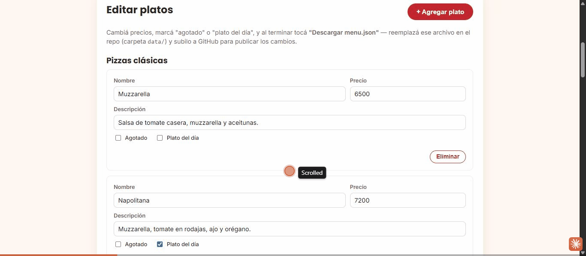

# menu-qr-demo

 

> [!CAUTION]
> **© 2026 Gonzalo Nicolás Bravo — IO Consulting. Todos los derechos reservados.**
>
> Este repositorio es público **solo** para publicar la demo con GitHub Pages. **No es software libre ni de código abierto.** No tenés permiso para copiar, clonar, modificar, redistribuir ni reutilizar este código o sus partes en otros proyectos, personales o comerciales, ni para usarlo en el entrenamiento de modelos de IA. El uso no autorizado infringe la Ley 11.723 de Propiedad Intelectual (Argentina). Condiciones completas en [`LICENSE`](LICENSE). Para pedir permisos: contacto@ioconsulting.com.ar.
>
> **All rights reserved.** This repository is public **only** to serve a GitHub Pages demo. **It is not free or open source software.** You may not copy, clone, modify, redistribute or reuse this code or any part of it in other projects, personal or commercial, or use it to train AI models. Unauthorized use infringes copyright. Full terms in [`LICENSE`](LICENSE). To request permission: contacto@ioconsulting.com.ar.


Menú digital para escanear por QR en la mesa, demo de portfolio de **IO Consulting**. Mismo caso de uso que `landing-comercio-demo` ("Pizzería IO Consulting"), para mostrar dos soluciones distintas sobre el mismo cliente ficticio.

## Problema que resuelve

El dueño de un restaurante cambia precios o se le agota un plato varias veces por semana, y reimprimir el menú en papel cada vez es caro y lento. Con este menú digital, el QR de la mesa siempre apunta a la misma página; lo que cambia es el contenido, editable sin tocar código ni depender de una imprenta.

## Demo

- Menú público: `https://ioconsultingarg.github.io/menu-qr-demo/`
- Panel del dueño (en la demo es de acceso libre y no puede publicar nada: solo descarga un archivo): `https://ioconsultingarg.github.io/menu-qr-demo/admin.html`



## Stack

- HTML/CSS/JS puro, sin build step
- Los datos del menú viven en `data/menu.json` — el "motor" de esta demo es justamente que el contenido está separado del código
- Generación de QR en el cliente con [qrcodejs](https://github.com/davidshimjs/qrcodejs) (CDN)
- Google Fonts (Poppins + Inter)

## Cómo correrlo local

El menú usa `fetch()` para cargar `data/menu.json`, así que no funciona abriendo `index.html` directo desde el explorador de archivos (protocolo `file://` bloquea el fetch). Levantá un servidor local simple:

```bash
python3 -m http.server 8000
# abrir http://localhost:8000
```

## Cómo editar el menú (versión demo)

1. Abrí `admin.html`, cambiá precios, marcá "agotado" o "plato del día", agregá o eliminá platos.
2. Tocá **"Descargar menu.json"** — se descarga el archivo actualizado.
3. Reemplazá `data/menu.json` en el repo por el descargado.
4. Commit + push (o `git push` desde VS Code) — GitHub Pages se actualiza solo en 1-2 minutos.

Es un paso manual a propósito: esta es la versión demo sin backend. En una implementación real para un cliente, el panel se conecta a Supabase o Google Sheets y los cambios se ven al instante, sin descargar ni subir nada.

## Cómo generar e imprimir el QR

`admin.html` genera automáticamente un QR que apunta a `index.html` en la URL donde esté publicado el sitio. Al abrir esa página, hacé clic derecho sobre el QR → "Guardar imagen como" para imprimirlo y pegarlo en las mesas.

## Estructura

```
menu-qr-demo/
├── index.html       (menú público — esto abre el QR)
├── admin.html        (panel del dueño + generador de QR)
├── 404.html          (página de enlace no encontrado)
├── assets/           (favicon, imagen para compartir el link, GIF del README)
├── css/styles.css
├── js/menu.js         (lógica del menú público)
├── js/admin.js         (lógica del editor y el QR)
├── data/menu.json       (contenido del menú)
├── README.md
└── LICENSE
```

## Próximas mejoras posibles

- Reemplazar el flujo de descarga/reemplazo manual por conexión real a Supabase o Google Sheets
- Autenticación simple para `admin.html` (hoy es solo "oculta", no protegida)
- Multi-idioma para zonas turísticas

---
Parte del portfolio de demos de transformación digital de IO Consulting.
